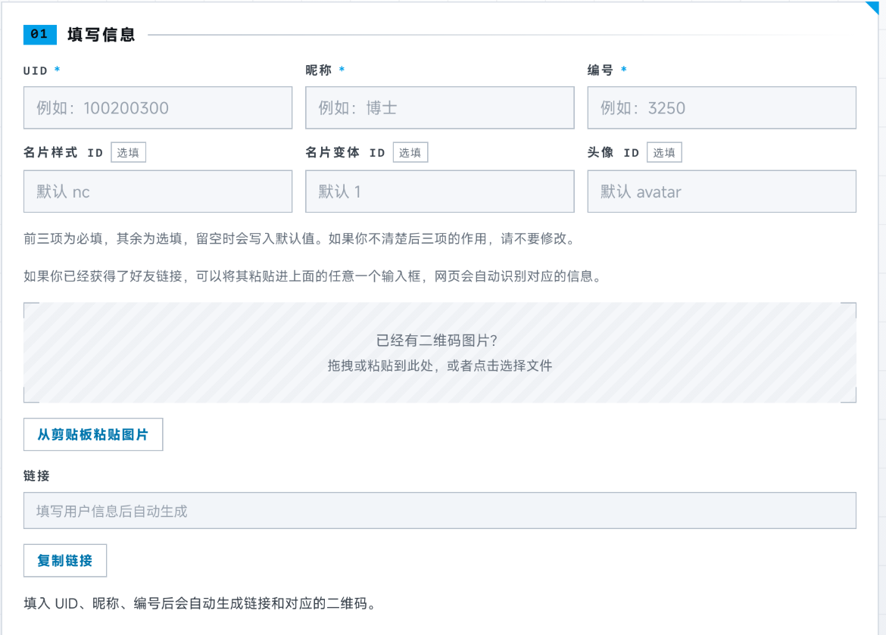
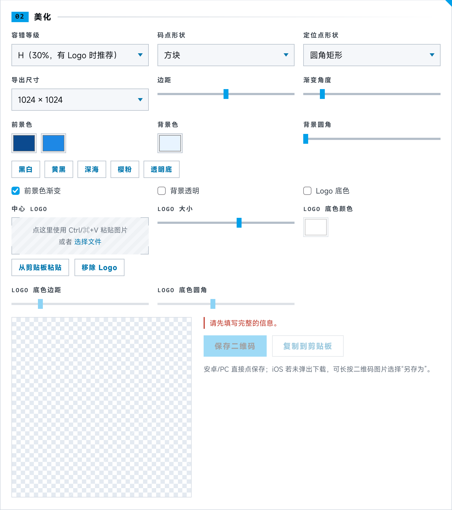
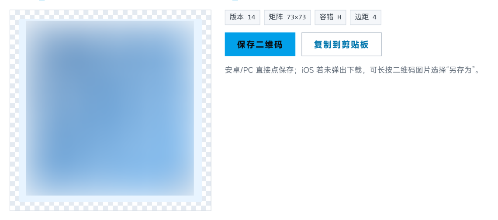
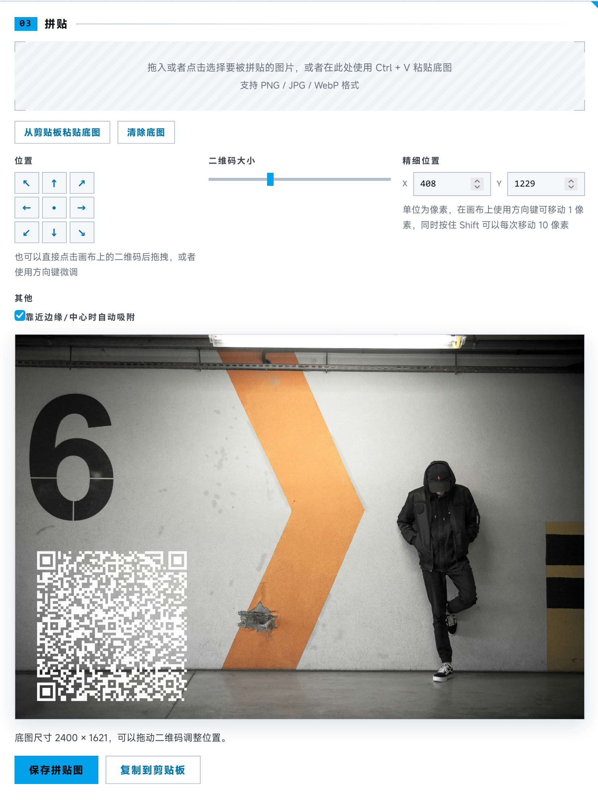

# 明日方舟好友二维码生成器

填好用户信息即可生成好友二维码，其他人只需要打开游戏即可扫描。

## 使用

## 填写信息



在页面的这部分填写 UID、昵称、编号即可。

比如对于一个 UID 为 `123256789` 的好友页面显示为 `博士#0799`的玩家，昵称处应当填写`博士`，编号处应当填写`0799`。

如果你知晓你当前使用的名片主题以及头像对应的ID，也可以填写其余三项，若要查询头像对应的ID，请参考[个人头像一览 - PRTS - 玩家共同构筑的明日方舟中文Wiki](https://prts.wiki/w/个人头像一览)。

> 如果你知晓名片主题 ID 等信息，欢迎开启一个 pull request 来补充对应的功能。

为了最大化二维码稳定性，推荐在游戏中获取二维码之后上传，页面会自动识别对应的信息。

## 美化二维码



填写完整的信息之后，此处的棋盘画布内应当出现一个二维码。通过上面的选项，可以对二维码进行进一步的自定义调整。



“前景色”可以调整二维码的主体部分的颜色，默认使用选定的第一个颜色。勾选“前景色渐变”之后，在“前景色”处选定的两个颜色会进行渐变混合，可以通过渐变角度滑块调整渐变的角度。

此外，还可以通过“中心logo”处上传一张图片，放置一张logo，并对其大小进行调整，如果要突出 logo，可以为 logo 添加底色，以增加区分度。

在完成自定义之后，可以通过点击“保存二维码”将其保存到本地，或者进行进一步的拼贴操作。

# 拼贴



完成对二维码的自定义之后，可以在此处上传图片，直接在页面上完成拼贴。

二维码的样式会跟随上一步的设置，如果对二维码的样式不满意，可以在上一步通过选项继续调整。

长按并拖动画布上二维码即可调整二维码的位置，同时“位置”处可以快速设定二维码的位置到指定位置。

如果需要精细化调整，可以在聚焦画布后通过按下键盘上的方向键来进一步调整位置，此时二维码将以每次一像素向选定的方向移动。

如果发现二维码放置在边缘和中心时无法进一步移动，可以尝试取消勾选“靠近边缘/中心时自动吸附”再尝试。

由于浏览器的限制，如果要对贴图进行进一步的定制，可以在上一步保存二维码，然后使用其它图片编辑工具进行设计和编辑。

## 开发

 项目采用基础的 Vite 的项目结构，下面是一些可能会用到的命令：

```bash
pnpm install # 安装依赖
pnpm dev # 启动开发服务器
pnpm build # 构建产物，默认情况下，构建产物存放在 dist/
pnpm preview # 预览构建产物
pnpm build:single # 构建单个 html 文件以便离线使用
pnpm icons # 由 src/favicon.svg 重新生成 favicon.ico 与 apple-touch-icon.png（需要提前安装 rsvg-convert 与 imagemagick）
```

### 部署在子目录

修改 `vite.config.js` 的 base 部分，请参考 https://vite.dev/guide/build#public-base-path。

或者使用单个 HTML 的构建。

## 免责声明

本项目由《明日方舟》游戏爱好者借助 LLM 制作。网站所涉及的公司名称、商标、产品等均为其各自所有者的资产，仅供识别。网站内使用的游戏图片、文本、设计，仅用于更好地表现网站功能，其版权属于上海鹰角网络科技有限公司及其关联公司。

由于链接生成的格式是经过尝试得出，所以存在官方链接格式变更导致本工具不可用的可能，本项目不提供永久可用的担保，但项目将尽力更新以提高可用性。

## 特别感谢

DeepSeek V4 Flash，以及帮助排查链接格式的群友们。

## License

Mozilla Public License，版本 2.0，详见 [LICENSE 文件](./LICENSE)，或者 https://www.mozilla.org/MPL/2.0/ 。